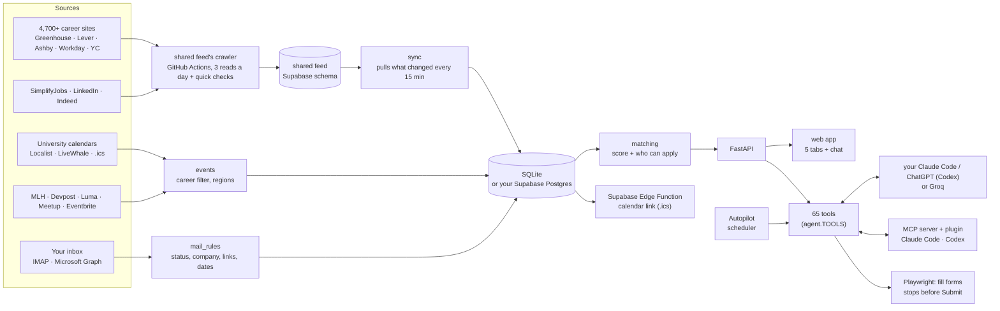

<div align="center">

# Co-op Coach

### Your AI co-op agent. It finds the internships, writes the applications and keeps score. You press Submit.

*273 people applied to the same internship. This is how you stop being one of them.*

<br/>

[](https://youtu.be/PQf5qarSaas)
[](#-try-it-in-one-command)
[](https://gaurangkhurana.ca)

<br/>


[Film](#-the-film) • [Features](#-what-it-does) • [How it works](#how-it-works) • [Try it](#-try-it-in-one-command)

</div>

---

## 🎬 The film

https://github.com/user-attachments/assets/b756de94-84a5-49fe-9bc4-72d0b98ada6f

<p align="center"><sub>Every shot is the real app running on a demo student, filmed by <code>tools/record_film.py</code>. Full quality on <a href="https://youtu.be/PQf5qarSaas">YouTube</a>.</sub></p>

## The problem

Co-op students send hundreds of applications into postings with hundreds of applicants each. Most of that work is
the same: find the postings you're actually allowed to apply to, rewrite the same answers, chase the inbox, forget to
prep. Everyone does it the same way, so everyone gets lost in the same pile.

## The fix

**Co-op Coach does the search and the paperwork, and leaves the decisions to you.** It watches 4,700+ company career
sites, ranks every posting against your résumé (including whether you can even apply), prepares the best ones each
morning, reads your recruiting email to move your tracker, and puts the interview on your calendar. Then it helps you
get ready for it.

<table>
<tr>
<td align="center" width="25%"><h3>27,000+</h3><sub>live postings in the shared feed, crawled 3× a day</sub></td>
<td align="center" width="25%"><h3>4,700+</h3><sub>company career sites read directly</sub></td>
<td align="center" width="25%"><h3>65</h3><sub>tools shared by the app, Jarvis, Claude Code and Chrome</sub></td>
<td align="center" width="25%"><h3>0</h3><sub>applications ever submitted without you</sub></td>
</tr>
</table>

## ✨ What it does

<table>
<tr>
<td width="50%"><br/><b>Today, with Jarvis.</b> Every morning Autopilot picks your best new matches, writes the answers, a tailored résumé and a cover letter, and lines them up in <i>Ready to apply</i>.</td>
<td width="50%"><br/><b>Matches.</b> About 22,000 live internships scored 0–100 against your résumé. It reads each posting <i>and its form</i> for who can apply, so you never waste one.</td>
</tr>
<tr>
<td><br/><b>Resume Studio.</b> Your résumé as a live document with a score and a checker. Describe a look and it redesigns it. Export PDF, Word or Jake's LaTeX. It never invents a number.</td>
<td><br/><b>Applications.</b> Connect Gmail or Outlook and recruiting mail moves each card by itself, from received to offer. Interviews land on your calendar.</td>
</tr>
<tr>
<td><br/><b>The Path.</b> The NeetCode 150 as a trail you come back to: timed tries, spaced review, tests, streaks and XP. Jarvis walks it with you.</td>
<td><br/><b>Tracks.</b> Browse by kind of role or employer: Quant, AI labs, Big Tech, Startups in Canada. New roles like Forward Deployed Engineer are found in the feed itself.</td>
</tr>
<tr>
<td><br/><b>Jarvis, a chat that acts.</b> "Prepare my top 3", "research Ramp before my interview", "I solved Two Sum in 12 minutes". 62 tools, every step shown, every change with an Undo.</td>
<td><br/><b>Events.</b> Info sessions, career fairs and hackathons from 31 universities plus Luma, MLH and Devpost, in one calendar you can subscribe to.</td>
</tr>
</table>

**Works where you already are:** a Claude Code plugin (`/coop-coach:apply Shopify`), an MCP server, and a Chrome
extension that fills the form on the page you're on, then stops before Submit.

<details>
<summary><b>Every feature, in detail</b></summary>

| | |
|---|---|
|  | **Today, with Jarvis.** Jarvis says what's ready, what's coming and what to do next. Autopilot's plan is one sentence you can click through ("Every day at 08:00, prepare 10 of my best matches..."), a preset (Chill 3 · Steady 10 · All-in 25 · Startups · Quant hunt · Remote), or something you tell Jarvis in your own words ("15 a day, only startups in Toronto, skip Amazon"). Up to 50 a run, prepared four at a time. Every morning it picks your best new matches (one per company, open to you), prepares each one (form answers, tailored resume, cover letter) into *Ready to apply*, and writes a one-paragraph brief. An *Apply session* walks you through them, filling each form in Chrome (Workday's multi-page applications too, in your existing signed-in session, stopping at the voluntary questions and at Review); you press Submit. It also writes follow-up drafts for quiet applications, a prep sheet when an interview lands, and a thank-you after it. |
|  | **The Path.** The search as a game you come back to, because consistency is what lands co-ops. It tracks the real work and never sets homework. It's a long trail through the [NeetCode 150](https://neetcode.io/practice) and nothing else: 231 stops across 18 topic sections, Arrays & Hashing to Bit Manipulation, with every problem a stop, real-work stops mixed in (your resume, applying, what comes back from companies, people, events, goals growing from 1 application to 150), a chest at the end of each topic, and **tests**: real problems picked for you, solved on LeetCode against the clock with no hints (one per topic, a checkpoint every three topics, a final across all 150). Pass for a badge and bonus XP; miss and it says what to review. They never lock anything. Link a public LeetCode username and accepted solves log themselves, and confirm test results (no password). Seven days in a row earn a shield that saves a streak on a missed day, and a year grid shows your whole run. Jarvis stands at the next problem, every stop stays open, and a map jumps to any topic. Tap a problem: *Start* opens it on LeetCode with a timer, then log Solved / Needed hints / Couldn't with your time and notes (links only, never the problem text; the 7 LeetCode Premium ones point to NeetCode). Misses come back for review after 2, 5 and 12 days; solve one again a week later, then three weeks after that, for 👑 crowns. XP comes from the work (apply 50, prepare 5, first solve Easy 20 / Medium 30 / Hard 50, a logged try 5, a crown 15, a chest 50, all 150 500, each of three daily quests 10), against a daily goal and a streak. 15 levels run from Booting to J.A.R.V.I.S., and Jarvis jumps for every milestone. Star a problem for a job, a track or a company, or just tell Jarvis "I solved Two Sum in 12 minutes". |
|  | **Matches.** About 22,000 live internships from 4,700+ career sites (Greenhouse, Lever, Ashby, Workday, SuccessFactors, Jibe, Y Combinator), SimplifyJobs, LinkedIn and Indeed, merged across sources and scored 0-100 for role, skills, location, term and freshness. It reads each posting *and its application form* for who can apply ("US residents only", "What state do you live in?"), so you never waste an application. *Download Excel* gives you every detail in one colour-coded workbook: matches (score, who can apply, pay, term, skills, links), your applications by status, what's ready to apply and the startups hiring, with filters, sorting and frozen headers. |
|  | **Tracks.** Jobs is *Matches*, then the tracks you pin, then *＋ Tracks*. A track is a kind of role (Software, ML & AI, Data, Quant roles, Hardware, Embedded, Infra & SRE, Security, Mobile, Product, Design, Business) or of employer (Startups in Canada, YC startups, Big Tech, Trading firms & funds, AI labs, Robotics & space, Chips & hardware, Fintech, Dev tools, Banks & financial firms, Other large employers, or one you start). New kinds of role are found in the feed itself, with no list to keep up: when enough companies keep posting a role no track covers (Forward Deployed Engineer: 72 open at 29 companies; GTM: 51 at 40), it becomes a track, marked *New* or *Rising* when it's spreading. Every track opens the same page: its *Postings* (the same rows as Matches, with their own filters), its *Companies* (hiring first, a segment picker, lesser-known firms flagged, who you know there, when firms usually open) and its *Market*. Pin it to the Jobs bar; follow it and its new roles always alert you. |
|  | **A track's companies and market.** What its postings that are open to you ask for: each skill's share, how many list it as *required* and how many as *nice to have* (from each posting's own headings), and whether it's rising; where and when (terms, cities, remote, postings per month, who can apply, when firms open); stated pay as an hourly figure (median and middle half, with quotes, nothing converted or guessed); your fit and top gaps. Every number opens exactly the postings behind it. Resume Studio's market fit reads the same numbers for any track, and each gap gets one honest action: add a skill your bullets already show, confirm one you have, or plan a project that builds it. Employer tracks keep their firm lists: *Trading firms & funds* maps 161 firms in 12 segments, with *Find more* (from your postings and your AI, each checked live) and reminders before firms open. More in [docs/MATCH.md](docs/MATCH.md). |
|  | **Startups in Canada.** A track of startups in Waterloo Region, Toronto and the rest of Canada (YC companies based here, the Waterloo & Toronto list, founders you know), fastest-hiring first: internships in Canada opened in the last 30 days (each once, however many boards list it) and how many roles their boards list against a month ago. *Watch* has the sync read a startup's job board. |
|  | **Applications.** Connect Gmail or Outlook (or just paste an email) and recruiting mail moves each application along by itself: received, assessment, interview, offer, rejection. Interviews, online assessments, recruiter calls, coffee chats and info sessions found in your email (a calendar invite, or a time written in the email) go on your calendar with a reminder; a moved or cancelled invite updates it, and only the item is kept, never the email. A pasted invite works the same way and finds the posting you never tracked. |
|  | **Resume Studio.** Your resume as an editable document with a live preview and a score. The checker proofreads first ("Inter" → "Intern", "MAy" → "May", lines split when the PDF was read) and fixes them in one click. Export PDF, Word or real Jake's Resume LaTeX (or open it in Overleaf). AI rewrites never invent numbers. |
|  | **Events.** Info sessions, career fairs, networking and hackathons from 31 universities in Canada and the US (Stanford, MIT, Cornell, Waterloo, Western, SFU...), Toronto organizers, Luma, Meetup, Eventbrite, MLH and Devpost. List, month and hackathon-season views, and one private calendar link for Apple, Google or Outlook. |
|  | **Jarvis, a chat that acts.** Jarvis (the little terminal from gkhurana's site) thinks while it works, writes its replies as you watch, cheers when you apply, and takes 🎤 voice. "Prepare my top 3", "research Ramp before my interview", "remind me Friday to follow up", "draft a referral ask", "how's my NeetCode?", "I solved Two Sum in 12 minutes", "what does the Forward Deployed market ask for?", "which smaller quant firms am I missing?", "who was the recruiter from RBC?", or paste a recruiter email. 62 tools, each step shown, with Undo. While the app is open, Jarvis's tools are answered by the running app itself, so a reply that uses two tools takes seconds. |

</details>

## ⚡ Try it in one command

```bash
git clone https://github.com/gkhurana21/co-op-coach.git && cd co-op-coach
./run.sh demo
```

Then open <http://127.0.0.1:8790>. On Windows, double-click `run-demo.bat`. The demo is a fictional student (Alex
Chen) with 250 real postings, 85 events, applications at every stage and a résumé with a few planted mistakes. No
account, no AI and no network needed; it lives in its own `data-demo/` folder.

## How it works



* **One set of tools, many drivers.** Everything the app can do (search, prepare, track, research, remind...) is a
  tool in `coopcoach/tools/`. The chat, Autopilot, chat-card buttons, and your own Claude Code or ChatGPT (through
  the MCP server and plugin) all call the same tools. Every call is logged with how to undo it.
* **Your own AI, no API key.** If the `claude` or Codex CLI is signed in, Co-op Coach runs it headless with only its
  own tools (no shell, no files) and gets JSON back. Groq is the free fallback. Contact details are replaced with
  placeholders before anything leaves your Mac.
* **Two databases, one API.** SQLite by default. Optionally your own Supabase project: a small translation layer
  (placeholders, `INSERT OR IGNORE` → `ON CONFLICT`, `LIKE` → `ILIKE`...) runs the same queries on Postgres. After a
  sync only changed postings are downloaded (md5 fingerprints), which keeps it inside the free plan.
* **Thousands of boards nobody added by hand.** About once a month, Co-op Coach reads Common Crawl's public index of
  the web for every Greenhouse, Ashby and Lever board it links to, plus SimplifyJobs' application links, checks each
  one live, and adds the real ones. Every YC company that says it's hiring has its jobs page read (what Work at a
  Startup lists, minus the sign-in).
* **One crawler for everyone, a pull in seconds.** A crawler (the ordinary sync, run by GitHub Actions against a
  Supabase schema with nobody's data in it) reads every board at 7:30, 12:30 and 17:30 Eastern, when companies post,
  with quick checks of the boards that just posted in between. Each posting records when it last changed and whether
  it's a real new opening (not a board's backlog), so each app pulls only what changed: inside the database when the
  app is in the same Supabase project, over Supabase's REST API otherwise. Scores, applications and resumes stay in
  each person's own database; boards someone added that the feed doesn't read are still read by their app, and if
  the crawler ever stops for half a day, every app goes back to reading every board itself. Setup is in
  `coopcoach/central.py` (`setup_sql`, `seed_sql`; `publish_sql` opens it to other people's apps, read-only).
* **A full sync in under a minute, a quick check in seconds.** Company boards are read by a few worker processes
  (one Python process spends more time on its own threads than on the network), and what's read is saved every 15
  seconds. A posting the board sends exactly as last time is neither re-read nor re-sent. Workday boards are read
  through their own internship filter where it proves complete (one request instead of six, and it finds internships
  the keyword search misses), plus only the searches a board needs, with a full read every day or two. Between full
  syncs, a quick check every 20 minutes reads the boards that matter to you (niches you follow, companies you starred
  or applied to, the boards behind your best matches, boards that just posted), one page each: Workday lists the
  newest first. AI scoring and alerts finish after the sync shows as done; each report times every step.
* **A calendar link that works when your Mac is off.** A Supabase Edge Function serves your saved events,
  interview times, assessment deadlines and reminders as an `.ics` feed. Only a hash of the link is stored.

## Principles

* **You submit.** Forms get filled; the Submit button is yours. A hook in the Claude Code plugin blocks it too.
* **No CAPTCHA solving, no account creation, no demographic answers.** When a site asks, you get a "Sign in
  yourself" button.
* **Never invent facts.** Letters, answers and rewrites use only your resume and the posting; anything only you
  know becomes a `[blank]`.
* **Secrets stay in the Keychain.** Inbox passwords, AI connections and the database password never
  touch the database.
* **Undo everything.** Every AI action is in the Activity log with an Undo.

## Engineering

* **Tests:** 64 suites, 1,700+ checks, each suite in its own process with its own temporary data folder:
  `.venv/bin/python -m tests.run_all`. Fakes stand in for the Claude Code and Codex CLIs, Groq, a Workday site (with a
  CAPTCHA and a honeypot field) and the university calendar APIs, so the suites run offline.
* **CI:** GitHub Actions runs ruff (pyflakes + import order) and every suite on each push.
* **Source checks:** `tools/discover_boards.py` re-mines career boards and keeps only ones that answer live;
  `tools/discover_event_sources.py --check` reads every university calendar and opens every hackathon site.
* **Proof it works:** `tools/walkthrough.py` does each feature's try-it step in a real browser on a copy of the demo; `tools/audit_ui.py` presses each different safe button on every page, and in the windows they open, at desktop, phone and light; `tools/plugin_e2e.py` runs the plugin's commands in real Claude Code; `tools/live_forms.py` tries the form filler on real application pages with all sending blocked; `tools/feed_check.py` checks every track's numbers on the live feed; `tools/bench.py` and `tools/bench_ui.py` time every page.
* **The film:** `tools/record_film.py` films the real app on the demo student (slow-motion capture, so every frame is smooth) and `tools/cut_film.py` cuts it with an original score.

```
coopcoach/
  server.py, routes_*.py   FastAPI app and routes
  tools/                   the tools (jobs, applications, calendar, profile)
  agent.py                 tool registry, logging + Undo, the chat loop
  autopilot.py             daily picks, preparation, brief, follow-ups, alerts
  matching.py, store.py    scoring, eligibility, postings cache
  tracks.py, tracks.yaml   tracks: kinds of role and of employer, pins, follows, each track's page
  track_discovery.py       new kinds of role found in the feed (Forward Deployed, GTM...)
  market.py, niches.py     a market's skills, pay and fit; the firm lists behind employer tracks (niches.yaml)
  path.py, leetcode.py     the Path: XP, streaks, levels, milestones, tests, the NeetCode 150 (coding.yaml); a linked public LeetCode profile
  meetings.py              interviews, assessments and coffee chats found in email, for the calendar
  hackathons.py, github.py hackathon applications; Devpost write-ups from a public GitHub repo
  startups.py, discover.py the Startups in Canada track; finding new career boards (Common Crawl, SimplifyJobs)
  workday_apply.py         filling Workday's multi-page applications (stops before Submit)
  export.py                the Excel workbook
  contacts.py              People: recruiters, LinkedIn connections, startup signals, funding
  sources/, sync.py        career-site readers and the sync
  central.py               the shared job feed: what each app pulls, the crawler's schema (crawl.yml runs it)
  events.py                event readers (Localist, LiveWhale, Tribe, iCal, Luma, MLH...), regions, hackathons
  mail.py, mail_rules.py   inbox connections; reading recruiting email
  outlook_web.py           Outlook on the web, signed in in Co-op Coach's own window
  resume*.py               resume parsing, Studio, checker, compare, PDF/Word/LaTeX
  claude_code.py, codex_cli.py, ai.py, groq_client.py   AI engines
  mcp_server.py            Co-op Coach as an MCP server
  db.py, supa.py           SQLite / Postgres, Supabase setup
supabase/functions/calendar   the calendar link
claude-plugin/              skills + Submit guard for Claude Code (and Codex)
tests/, tools/              suites and maintenance scripts
```

## Using it for real


You need a Mac with Python 3.10+ (`brew install python@3.12`), Google Chrome and git.

```bash
./run.sh            # first run sets everything up, then http://127.0.0.1:8765
```

Add yourself, set a passcode, upload your resume in Settings → Profile, and say what you're looking for. A friend can
have their own profile (and passcode) on the same Mac, or run their own copy.

<details><summary><b>AI: your Claude Code, ChatGPT, or free Groq</b></summary>

Everything works without AI. Settings → AI picks the engine:
* **Claude Code** or **ChatGPT (Codex)**: if the CLI is installed and signed in, your plan does all the AI work, with
  no API key. *Connect* also installs the Co-op Coach plugin, so in Claude Code you can type `/coop-coach:autopilot`,
  `/coop-coach:apply Shopify`, `/coop-coach:match quant`, `/coop-coach:interview-prep RBC`... (in Codex: `$autopilot`, or just ask).
* **Groq (free)**: get a key at <https://console.groq.com/keys> and set `GROQ_API_KEY=` in `.env`.
</details>

<details><summary><b>Inbox: Gmail, Outlook, iCloud, any IMAP</b></summary>

Settings → Inbox → *Connect an inbox* and type your address; the steps for your provider appear. Tip: use
a separate email just for applications. Gmail, Yahoo and iCloud use an app password. Outlook, Hotmail and school
Microsoft 365: press *Sign in to Outlook* and sign in in the window that opens, as you would in a browser (Duo included).
It needs no IT approval and no app registration. The window reads your first emails and closes by itself; after that it
reads only what Outlook's own search finds for recruiting words, and *Sign in again* is there when your school ends the
session (Co-op Coach never sees your password, and keeps the sign-in in that window's own profile). If you'd rather use Microsoft's API, register an app once:
1. <https://entra.microsoft.com> → App registrations → New registration ("Accounts in any organizational directory
   and personal Microsoft accounts", no redirect URI).
2. Authentication → *Allow public client flows: Yes*. API permissions → Microsoft Graph → Delegated → `Mail.Read`.
3. Paste the Application (client) ID in the app (it isn't a secret), then sign in with the code it shows.

The first scan reads the last 120 days. Statuses only move forward; fix any email from *Inbox activity*. No inbox?
Paste an email into the chat or Applications.
</details>


<details><summary><b>Your data in Supabase, and the calendar link</b></summary>

1. Create a free project, then make the app's database login. The password is generated on your Mac and goes
   straight to the Keychain; the project only gets a one-way hash:
   `.venv/bin/python -c "from coopcoach import supa; print(supa.setup_sql(supa.new_credentials('<project ref>')))"`
   and run the printed SQL in the project's SQL editor.
2. `.venv/bin/python -m coopcoach supabase --connect <project ref> --region <region> --move` copies every table
   (checking counts) and switches. `--local` switches back; the local file is kept as a backup.
3. Deploy `supabase/functions/calendar` (with JWT verification off; the long random token in the URL is the key).

Tables live in a private `coopcoach` schema the public API can't reach.
</details>

<details><summary><b>Alerts, passcodes, background syncs</b></summary>

* **Alerts:** phone push with [ntfy](https://ntfy.sh) (a hard-to-guess topic), a Discord webhook, or email (SMTP in
  `.env`). Mac banners are always on.
* **Passcodes** are salted PBKDF2 hashes; the app auto-locks after 30 idle minutes. Forgot it? On this Mac:
  `.venv/bin/python -m coopcoach reset-passcode "Your Name"`. It's a lock, not disk encryption.
* **Syncing while the app is closed:** `0 */3 * * * cd /path/to/coop-coach && .venv/bin/python -m coopcoach sync`
  in `crontab -e`.
</details>

## Privacy

Your data stays in `data/` on your Mac (or your own Supabase project), including the recruiters you hear from.
Passwords and sign-in tokens are in the macOS Keychain; your private calendar link's token is in the database, like the
link itself. Nothing is sent anywhere except requests to job and event sites, the Workday sites you saved logins for,
your alert channels, and the AI you chose. Your Claude Code, Codex and Groq get your text with contact details
redacted; with your own Anthropic API key, it goes to Anthropic's API as is. The one exception is when you ask your
own Claude or ChatGPT to fill a form: it then gets the answers it's typing in.

## Notes and credits

* LinkedIn's terms restrict automated access; its search is small and slow on purpose (`sources.linkedin.enabled:
  false` turns it off). Indeed goes through the open-source `python-jobspy`.
* Jake's Resume LaTeX template by Jake Gutierrez (MIT), based on sb2nov/resume. The LaTeX export was inspired by
  Martin Sit's [makeitjakes](https://github.com/martin226/makeitjakes) (MIT).

## License

MIT. See [LICENSE](LICENSE).
