<div align="center">

# Co-op Coach

### Your AI co-op agent. It finds the internships, writes the applications and keeps score. You press Submit.

*273 people applied to the same internship. This is how you stop being one of them.*

<br/>

[](https://youtu.be/PQf5qarSaas)
[](#-try-it-in-one-command)
[](https://gaurangkhurana.ca)

<br/>


[Film](#-the-film) • [Features](#-what-it-does) • [How it works](#how-it-works) • [Try it](#-try-it-in-one-command)

</div>

---

## 🎬 The film

https://github.com/user-attachments/assets/b756de94-84a5-49fe-9bc4-72d0b98ada6f

<p align="center"><sub>Every shot is the real app running on a demo student, filmed by <code>tools/record_film.py</code>. Full quality on <a href="https://youtu.be/PQf5qarSaas">YouTube</a>.</sub></p>

## The problem

Co-op students send hundreds of applications into postings with hundreds of applicants each. Most of that work is
the same: find the postings you're actually allowed to apply to, rewrite the same answers, chase the inbox, forget to
prep. Everyone does it the same way, so everyone gets lost in the same pile.

## The fix

**Co-op Coach does the search and the paperwork, and leaves the decisions to you.** It watches 4,700+ company career
sites, ranks every posting against your résumé (including whether you can even apply), prepares the best ones each
morning, reads your recruiting email to move your tracker, and puts the interview on your calendar. Then it helps you
get ready for it.

<table>
<tr>
<td align="center" width="25%"><h3>27,000+</h3><sub>live postings in the shared feed, crawled 3× a day</sub></td>
<td align="center" width="25%"><h3>4,700+</h3><sub>company career sites read directly</sub></td>
<td align="center" width="25%"><h3>65</h3><sub>tools shared by the app, Jarvis, Claude Code and Chrome</sub></td>
<td align="center" width="25%"><h3>1,719</h3><sub>automated checks across 64 test suites</sub></td>
</tr>
</table>

## ✨ What it does

<table>
<tr>
<td width="50%">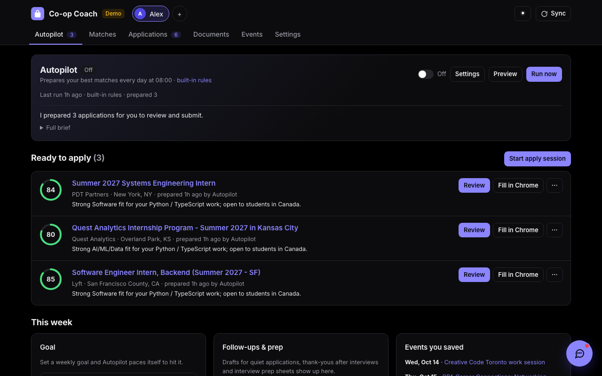<br/><b>Today, with Jarvis.</b> Every morning Autopilot picks your best new matches, writes the answers, a tailored résumé and a cover letter, and lines them up in <i>Ready to apply</i>.</td>
<td width="50%">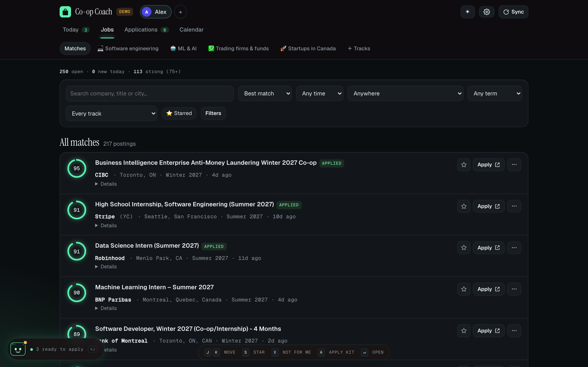<br/><b>Matches.</b> About 22,000 live internships scored 0–100 against your résumé. It reads each posting <i>and its form</i> for who can apply, so you never waste one.</td>
</tr>
<tr>
<td>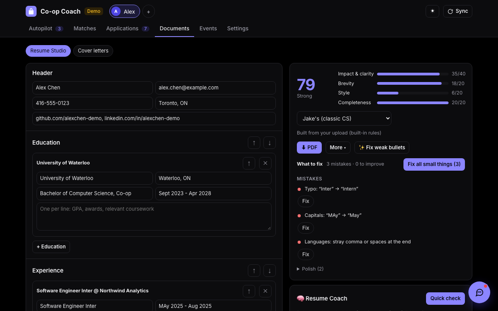<br/><b>Resume Studio.</b> Your résumé as a live document with a score and a checker. Describe a look and it redesigns it. Export PDF, Word or Jake's LaTeX. It never invents a number.</td>
<td>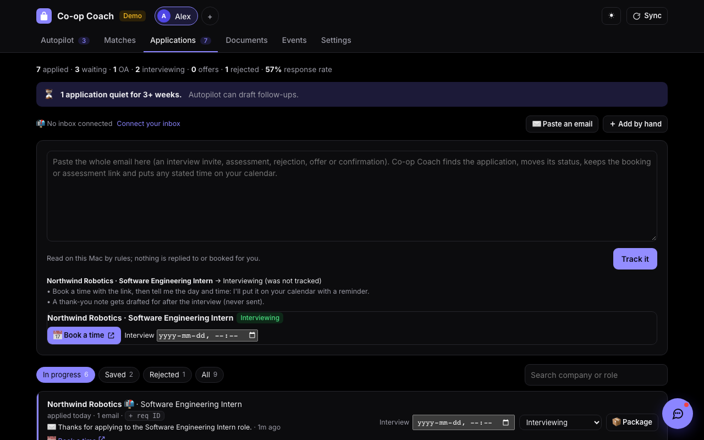<br/><b>Applications.</b> Connect Gmail or Outlook and recruiting mail moves each card by itself, from received to offer. Interviews land on your calendar.</td>
</tr>
<tr>
<td>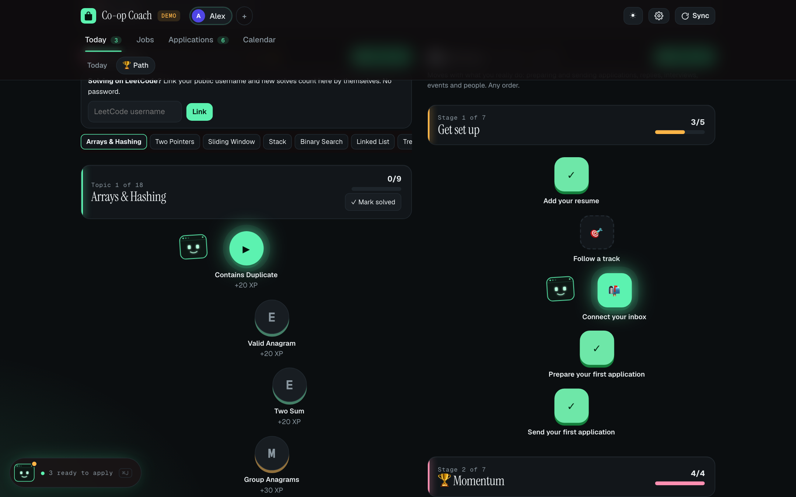<br/><b>The Path.</b> The NeetCode 150 as a trail you come back to: timed tries, spaced review, tests, streaks and XP. Jarvis walks it with you.</td>
<td>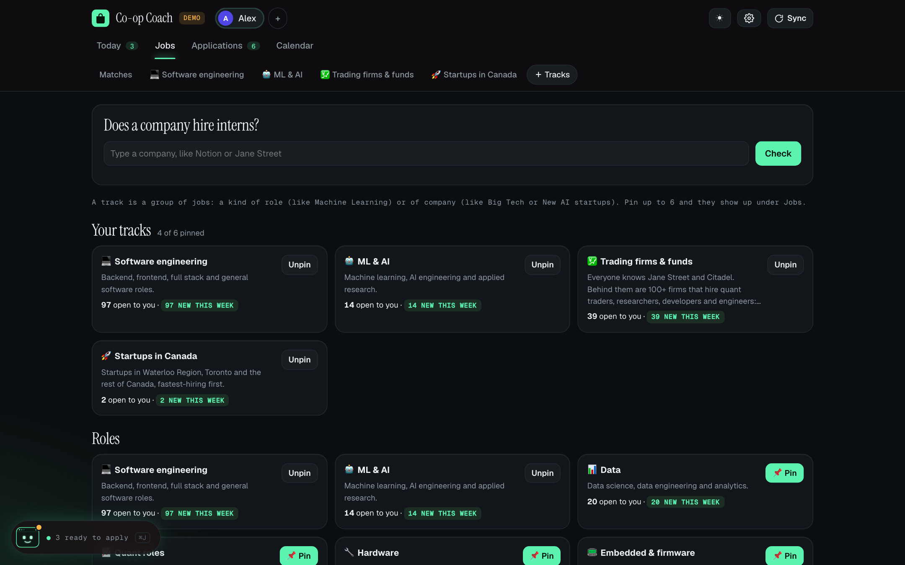<br/><b>Tracks.</b> Browse by kind of role or employer: Quant, AI labs, Big Tech, Startups in Canada. New roles like Forward Deployed Engineer are found in the feed itself.</td>
</tr>
<tr>
<td>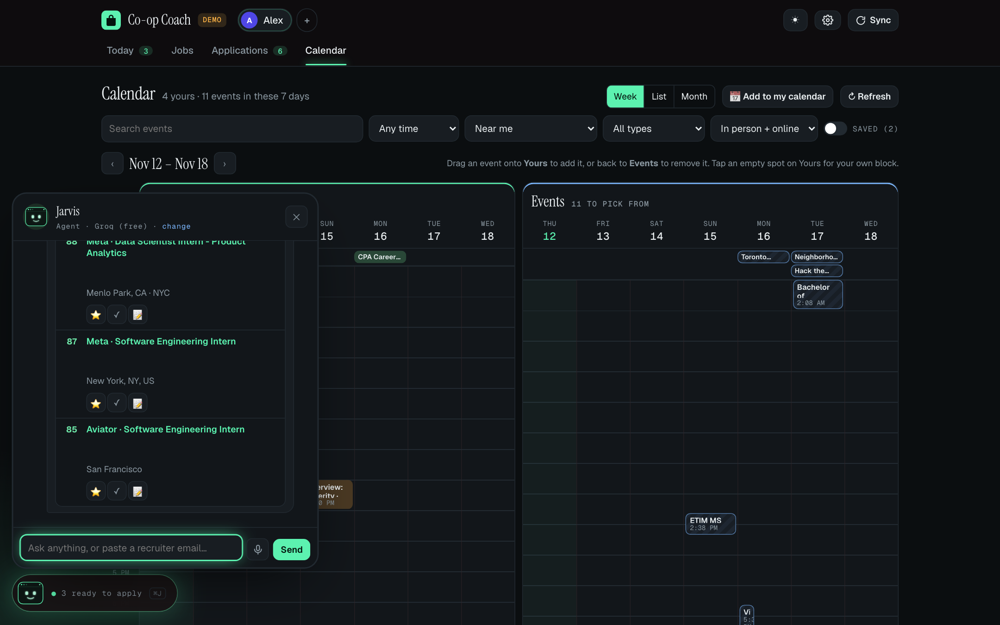<br/><b>Jarvis, a chat that acts.</b> "Prepare my top 3", "research Ramp before my interview", "I solved Two Sum in 12 minutes". 62 tools, every step shown, every change with an Undo.</td>
<td>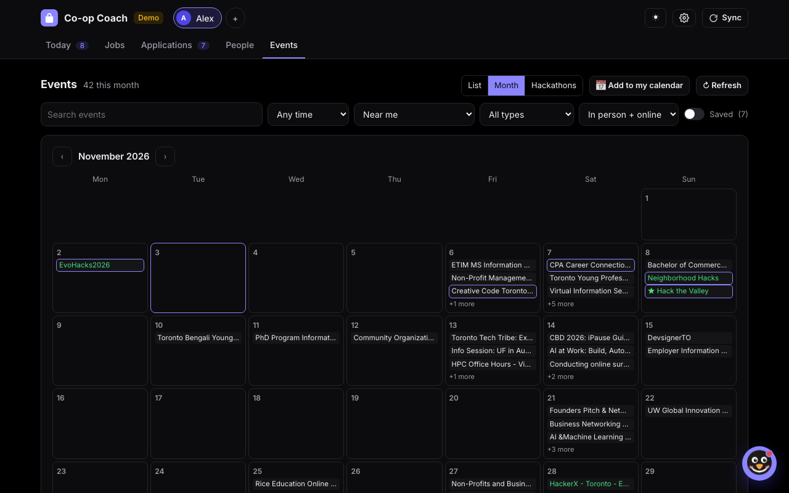<br/><b>Events.</b> Info sessions, career fairs and hackathons from 31 universities plus Luma, MLH and Devpost, in one calendar you can subscribe to.</td>
</tr>
</table>

**Works where you already are:** a Claude Code plugin (`/coop-coach:apply Shopify`), an MCP server, and a Chrome
extension that fills the form on the page you're on, then stops before Submit.

<details>
<summary><b>Every feature, in detail</b></summary>

| | |
|---|---|
|  | **Today, with Jarvis.** Jarvis says what's ready, what's coming and what to do next. Autopilot's plan is one sentence you can click through ("Every day at 08:00, prepare 10 of my best matches..."), a preset (Chill 3 · Steady 10 · All-in 25 · Startups · Quant hunt · Remote), or something you tell Jarvis in your own words ("15 a day, only startups in Toronto, skip Amazon"). Up to 50 a run, prepared four at a time. Every morning it picks your best new matches (one per company, open to you), prepares each one (form answers, tailored resume, cover letter) into *Ready to apply*, and writes a one-paragraph brief. An *Apply session* walks you through them, filling each form in Chrome (Workday's multi-page applications too, in your existing signed-in session, stopping at the voluntary questions and at Review); you press Submit. It also writes follow-up drafts for quiet applications, a prep sheet when an interview lands, and a thank-you after it. |
|  | **The Path.** The search as a game you come back to, because consistency is what lands co-ops. It tracks the real work and never sets homework. It's a long trail through the [NeetCode 150](https://neetcode.io/practice) and nothing else: 231 stops across 18 topic sections, Arrays & Hashing to Bit Manipulation, with every problem a stop, real-work stops mixed in (your resume, applying, what comes back from companies, people, events, goals growing from 1 application to 150), a chest at the end of each topic, and **tests**: real problems picked for you, solved on LeetCode against the clock with no hints (one per topic, a checkpoint every three topics, a final across all 150). Pass for a badge and bonus XP; miss and it says what to review. They never lock anything. Link a public LeetCode username and accepted solves log themselves, and confirm test results (no password). Seven days in a row earn a shield that saves a streak on a missed day, and a year grid shows your whole run. Jarvis stands at the next problem, every stop stays open, and a map jumps to any topic. Tap a problem: *Start* opens it on LeetCode with a timer, then log Solved / Needed hints / Couldn't with your time and notes (links only, never the problem text; the 7 LeetCode Premium ones point to NeetCode). Misses come back for review after 2, 5 and 12 days; solve one again a week later, then three weeks after that, for 👑 crowns. XP comes from the work (apply 50, prepare 5, first solve Easy 20 / Medium 30 / Hard 50, a logged try 5, a crown 15, a chest 50, all 150 500, each of three daily quests 10), against a daily goal and a streak. 15 levels run from Booting to J.A.R.V.I.S., and Jarvis jumps for every milestone. Star a problem for a job, a track or a company, or just tell Jarvis "I solved Two Sum in 12 minutes". |
|  | **Matches.** About 22,000 live internships from 4,700+ career sites (Greenhouse, Lever, Ashby, Workday, SuccessFactors, Jibe, Y Combinator), SimplifyJobs, LinkedIn and Indeed, merged across sources and scored 0-100 for role, skills, location, term and freshness. It reads each posting *and its application form* for who can apply ("US residents only", "What state do you live in?"), so you never waste an application. *Download Excel* gives you every detail in one colour-coded workbook: matches (score, who can apply, pay, term, skills, links), your applications by status, what's ready to apply and the startups hiring, with filters, sorting and frozen headers. |
|  | **Tracks.** Jobs is *Matches*, then the tracks you pin, then *＋ Tracks*. A track is a kind of role (Software, ML & AI, Data, Quant roles, Hardware, Embedded, Infra & SRE, Security, Mobile, Product, Design, Business) or of employer (Startups in Canada, YC startups, Big Tech, Trading firms & funds, AI labs, Robotics & space, Chips & hardware, Fintech, Dev tools, Banks & financial firms, Other large employers, or one you start). New kinds of role are found in the feed itself, with no list to keep up: when enough companies keep posting a role no track covers (Forward Deployed Engineer: 72 open at 29 companies; GTM: 51 at 40), it becomes a track, marked *New* or *Rising* when it's spreading. Every track opens the same page: its *Postings* (the same rows as Matches, with their own filters), its *Companies* (hiring first, a segment picker, lesser-known firms flagged, who you know there, when firms usually open) and its *Market*. Pin it to the Jobs bar; follow it and its new roles always alert you. |
| 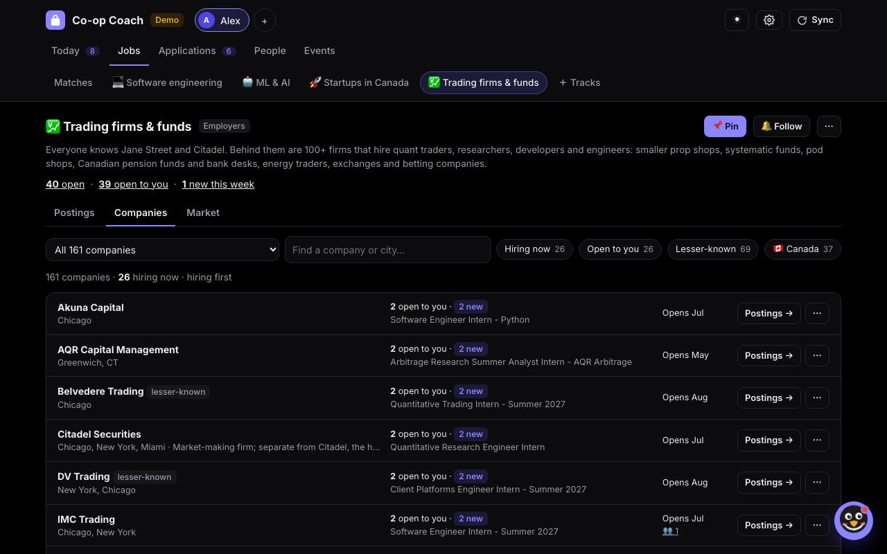 | **A track's companies and market.** What its postings that are open to you ask for: each skill's share, how many list it as *required* and how many as *nice to have* (from each posting's own headings), and whether it's rising; where and when (terms, cities, remote, postings per month, who can apply, when firms open); stated pay as an hourly figure (median and middle half, with quotes, nothing converted or guessed); your fit and top gaps. Every number opens exactly the postings behind it. Resume Studio's market fit reads the same numbers for any track, and each gap gets one honest action: add a skill your bullets already show, confirm one you have, or plan a project that builds it. Employer tracks keep their firm lists: *Trading firms & funds* maps 161 firms in 12 segments, with *Find more* (from your postings and your AI, each checked live) and reminders before firms open. More in [docs/MATCH.md](docs/MATCH.md). |
| 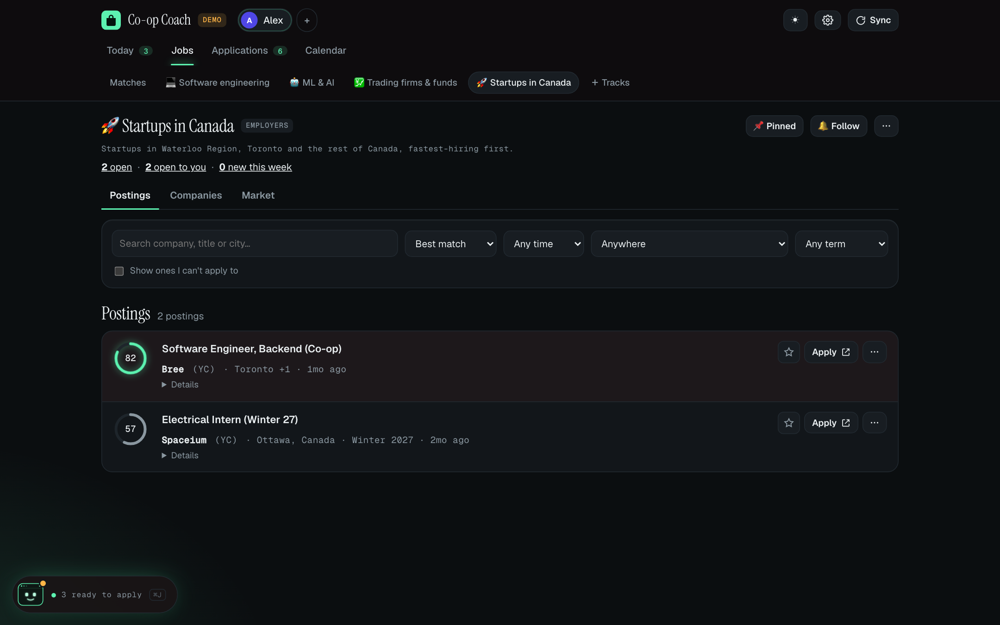 | **Startups in Canada.** A track of startups in Waterloo Region, Toronto and the rest of Canada (YC companies based here, the Waterloo & Toronto list, founders you know), fastest-hiring first: internships in Canada opened in the last 30 days (each once, however many boards list it) and how many roles their boards list against a month ago. *Watch* has the sync read a startup's job board. |
|  | **Applications.** Connect Gmail or Outlook (or just paste an email) and recruiting mail moves each application along by itself: received, assessment, interview, offer, rejection. Interviews, online assessments, recruiter calls, coffee chats and info sessions found in your email (a calendar invite, or a time written in the email) go on your calendar with a reminder; a moved or cancelled invite updates it, and only the item is kept, never the email. A pasted invite works the same way and finds the posting you never tracked. |
|  | **Resume Studio.** Your resume as an editable document with a live preview and a score. The checker proofreads first ("Inter" → "Intern", "MAy" → "May", lines split when the PDF was read) and fixes them in one click. Export PDF, Word or real Jake's Resume LaTeX (or open it in Overleaf). AI rewrites never invent numbers. |
|  | **Events.** Info sessions, career fairs, networking and hackathons from 31 universities in Canada and the US (Stanford, MIT, Cornell, Waterloo, Western, SFU...), Toronto organizers, Luma, Meetup, Eventbrite, MLH and Devpost. List, month and hackathon-season views, and one private calendar link for Apple, Google or Outlook. |
|  | **Jarvis, a chat that acts.** Jarvis (the little terminal from gkhurana's site) thinks while it works, writes its replies as you watch, cheers when you apply, and takes 🎤 voice. "Prepare my top 3", "research Ramp before my interview", "remind me Friday to follow up", "draft a referral ask", "how's my NeetCode?", "I solved Two Sum in 12 minutes", "what does the Forward Deployed market ask for?", "which smaller quant firms am I missing?", "who was the recruiter from RBC?", or paste a recruiter email. 62 tools, each step shown, with Undo. While the app is open, Jarvis's tools are answered by the running app itself, so a reply that uses two tools takes seconds. |

</details>

## ⚡ Try it in one command

```bash
git clone https://github.com/gkhurana21/co-op-coach.git && cd co-op-coach
./run.sh demo
```

Then open <http://127.0.0.1:8790>. On Windows, double-click `run-demo.bat`. The demo is a fictional student (Alex
Chen) with 250 real postings, 85 events, applications at every stage and a résumé with a few planted mistakes. No
account, no AI and no network needed; it lives in its own `data-demo/` folder.

## How it works

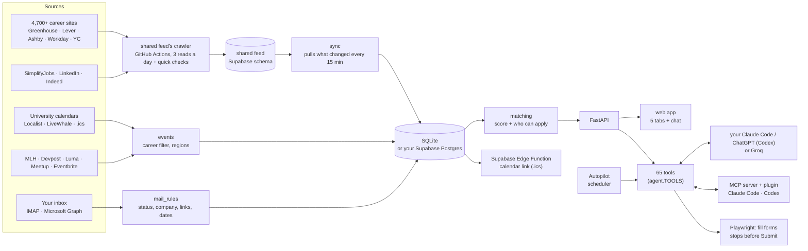

* **One set of tools, many drivers.** The app, Jarvis, Autopilot, Claude Code (MCP + plugin) and the Chrome extension all call the same 65 tools in `coopcoach/tools/`. Every call is logged with an Undo.
* **One crawler for everyone.** GitHub Actions reads every board three times a day into a shared Supabase feed; each app pulls only what changed, in seconds.
* **Your own AI, no API key.** A signed-in Claude Code or Codex runs headless with only Co-op Coach's tools. Groq is the free fallback. Contact details are redacted first.

## Principles

* **You press Submit.** Forms get filled; a hook in the Claude Code plugin blocks Submit too.
* **No CAPTCHAs, no account creation, no invented facts.** Anything only you know becomes a `[blank]`.
* **Your data stays yours.** Everything lives on your Mac (or your own Supabase); secrets stay in the Keychain.

## Engineering

* **1,719 checks in 64 suites**, each in its own process, with fakes for Claude Code, Codex, Groq, Workday and the university calendars, so they run offline. CI runs ruff and every suite on each push.
* **Real-browser proof:** `tools/walkthrough.py` clicks through every feature, `tools/audit_ui.py` presses every safe button at desktop and phone sizes, and `tools/live_forms.py` tests the form filler on real pages with sending blocked.
* **The film** is the real app, recorded by `tools/record_film.py` and cut by `tools/cut_film.py`.

## Run it for real

```bash
./run.sh    # sets everything up, then http://127.0.0.1:8765
```

Needs a Mac with Python 3.10+, Chrome and git. Inbox, AI engines, Supabase, alerts and privacy details are in
[docs/SETUP.md](docs/SETUP.md).

## Credits

Jake's Resume LaTeX template by Jake Gutierrez (MIT). The LaTeX export was inspired by Martin Sit's
[makeitjakes](https://github.com/martin226/makeitjakes). LinkedIn search is off-switchable (`sources.linkedin.enabled: false`);
Indeed goes through `python-jobspy`.

## License

MIT. See [LICENSE](LICENSE).
