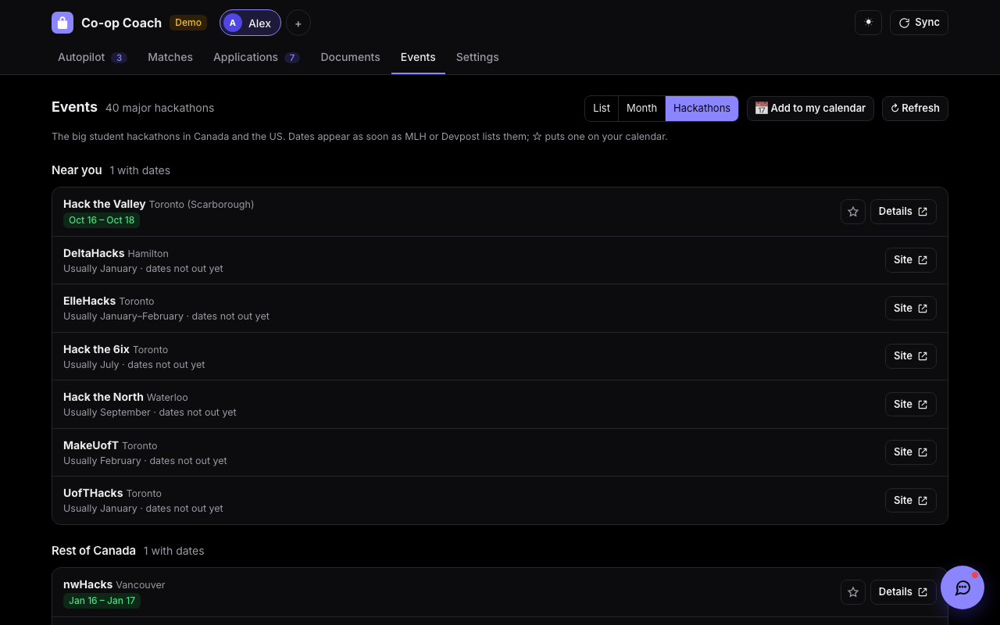
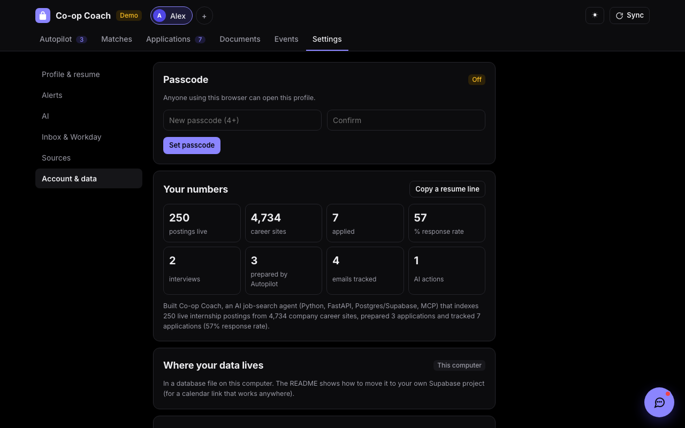
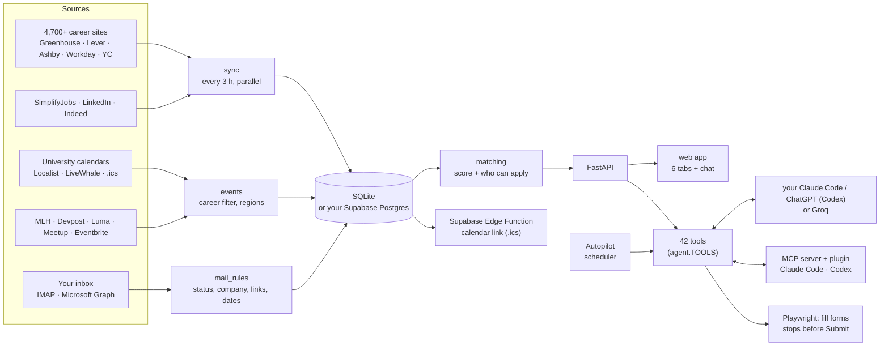

# Co-op Coach

**An AI job-search agent for internship and co-op students.** It watches 4,700+ company career sites, ranks every
posting against your resume (including whether you're even allowed to apply), prepares applications for you each
morning, reads your recruiting email to keep your tracker current, and finds career events and hackathons at 30+
universities. It runs on your own Mac, and the AI is your own Claude Code or ChatGPT, or free Groq.

It never presses Submit, never solves a CAPTCHA, and every change an AI makes has an Undo.


## Try it in one command

```bash
git clone https://github.com/gkhurana21/co-op-coach.git && cd co-op-coach
./run.sh demo
```

Then open <http://127.0.0.1:8790>. The demo is a fictional student (Alex Chen) with 250 real postings and 85 events
from a snapshot, applications at every stage, and a resume with a few planted mistakes. It needs no account, no AI
and no network, and it lives in its own `data-demo/` folder.

## What it does

| | |
|---|---|
|  | **Autopilot.** Every morning it picks your best new matches (one per company, open to you), prepares each one (form answers, tailored resume, cover letter) into *Ready to apply*, and writes a one-paragraph brief. An *Apply session* walks you through them; you press Submit. It also writes follow-up drafts for quiet applications, a prep sheet when an interview lands, and a thank-you after it. |
|  | **Matches.** About 22,000 live internships from 4,700+ career sites (Greenhouse, Lever, Ashby, Workday, SuccessFactors, Jibe, Y Combinator), SimplifyJobs, LinkedIn and Indeed, merged across sources and scored 0-100 for role, skills, location, term and freshness. It reads each posting *and its application form* for who can apply ("US residents only", "What state do you live in?"), so you never waste an application. |
|  | **Applications.** Connect Gmail or Outlook (or just paste an email) and recruiting mail moves each application along by itself: received, assessment, interview, offer, rejection. A pasted interview invite finds the posting you never tracked, keeps the booking link, and puts the time on your calendar. |
|  | **Resume Studio.** Your resume as an editable document with a live preview and a score. The checker proofreads first ("Inter" → "Intern", "MAy" → "May", lines split when the PDF was read) and fixes them in one click. Export PDF, Word or real Jake's Resume LaTeX (or open it in Overleaf). AI rewrites never invent numbers. |
|  | **Events.** Info sessions, career fairs, networking and hackathons from 31 universities in Canada and the US (Stanford, MIT, Cornell, Waterloo, Western, SFU...), Toronto organizers, Luma, Meetup, Eventbrite, MLH and Devpost. List, month and hackathon-season views, and one private calendar link for Apple, Google or Outlook. |
|  | **Hackathon season.** The 40 big student hackathons (Hack the North, UofTHacks, TreeHacks, HackMIT, Cal Hacks...), with real dates as soon as MLH or Devpost lists them, otherwise when each usually happens. |
|  | **A chat that acts.** "Prepare my top 3", "research Ramp before my interview", "remind me Friday to follow up", "draft a referral ask", "mock interview me", or paste a recruiter email. 42 tools, each step shown, with Undo. |
|  | **Your numbers.** Real counts (postings, applications, response rate, interviews) and a resume line built only from them. |

## How it works



* **One set of tools, many drivers.** Everything the app can do (search, prepare, track, research, remind...) is a
  tool in `coopcoach/tools/`. The chat, Autopilot, chat-card buttons, and your own Claude Code or ChatGPT (through
  the MCP server and plugin) all call the same tools. Every call is logged with how to undo it.
* **Your own AI, no API key.** If the `claude` or Codex CLI is signed in, Co-op Coach runs it headless with only its
  own tools (no shell, no files) and gets JSON back. Groq is the free fallback. Contact details are replaced with
  placeholders before anything leaves your Mac.
* **Two databases, one API.** SQLite by default. Optionally your own Supabase project: a small translation layer
  (placeholders, `INSERT OR IGNORE` → `ON CONFLICT`, `LIKE` → `ILIKE`...) runs the same queries on Postgres. After a
  sync only changed postings are downloaded (md5 fingerprints), which keeps it inside the free plan.
* **A calendar link that works when your Mac is off.** A Supabase Edge Function serves your saved events,
  interview times, assessment deadlines and reminders as an `.ics` feed. Only a hash of the link is stored.

## Principles

* **You submit.** Forms get filled; the Submit button is yours. A hook in the Claude Code plugin blocks it too.
* **No CAPTCHA solving, no account creation, no demographic answers.** When a site asks, you get a "Sign in
  yourself" button.
* **Never invent facts.** Letters, answers and rewrites use only your resume and the posting; anything only you
  know becomes a `[blank]`.
* **Secrets stay in the Keychain.** Inbox passwords, Workday logins, AI connections and the database password never
  touch the database.
* **Undo everything.** Every AI action is in the Activity log with an Undo.

## Engineering

* **Tests:** 23 suites, 425 checks, each suite in its own process with its own temporary data folder:
  `.venv/bin/python -m tests.run_all`. Fakes stand in for the Claude Code and Codex CLIs, Groq, a Workday site (with a
  CAPTCHA and a honeypot field) and the university calendar APIs, so the suites run offline.
* **CI:** GitHub Actions runs ruff (pyflakes + import order) and every suite on each push.
* **Source checks:** `tools/discover_boards.py` re-mines career boards and keeps only ones that answer live;
  `tools/discover_event_sources.py --check` reads every university calendar and opens every hackathon site.
* **Demo assets:** `tools/record_demo.py` drives the demo with Playwright and records the screenshots and GIF above.

```
coopcoach/
  server.py, routes_*.py   FastAPI app and routes
  tools/                   the tools (jobs, applications, calendar, profile)
  agent.py                 tool registry, logging + Undo, the chat loop
  autopilot.py             daily picks, preparation, brief, follow-ups, alerts
  matching.py, store.py    scoring, eligibility, postings cache
  sources/, sync.py        career-site readers and the sync
  events.py                event readers (Localist, LiveWhale, Tribe, iCal, Luma, MLH...), regions, hackathons
  mail.py, mail_rules.py   inbox connections; reading recruiting email
  resume*.py               resume parsing, Studio, checker, compare, PDF/Word/LaTeX
  claude_code.py, codex_cli.py, ai.py, groq_client.py   AI engines
  mcp_server.py            Co-op Coach as an MCP server
  db.py, supa.py           SQLite / Postgres, Supabase setup
supabase/functions/calendar   the calendar link
claude-plugin/              skills + Submit guard for Claude Code (and Codex)
tests/, tools/              suites and maintenance scripts
```

## Using it for real

You need a Mac with Python 3.10+ (`brew install python@3.12`), Google Chrome and git.

```bash
./run.sh            # first run sets everything up, then http://127.0.0.1:8765
```

Add yourself, set a passcode, upload your resume in Settings → Profile, and say what you're looking for. A friend can
have their own profile (and passcode) on the same Mac, or run their own copy.

<details><summary><b>AI: your Claude Code, ChatGPT, or free Groq</b></summary>

Everything works without AI. Settings → AI picks the engine:
* **Claude Code** or **ChatGPT (Codex)**: if the CLI is installed and signed in, your plan does all the AI work, with
  no API key. *Connect* also installs the Co-op Coach plugin, so in Claude Code you can type `/coop-coach:autopilot`,
  `/coop-coach:apply Shopify`, `/coop-coach:interview-prep RBC`... (in Codex: `$autopilot`, or just ask).
* **Groq (free)**: get a key at <https://console.groq.com/keys> and set `GROQ_API_KEY=` in `.env`.
</details>

<details><summary><b>Inbox: Gmail, Outlook, iCloud, any IMAP</b></summary>

Settings → Inbox & Workday → *Connect an inbox* and type your address; the steps for your provider appear. Tip: use
a separate email just for applications. Gmail, Yahoo and iCloud use an app password. Outlook/Hotmail and school
Microsoft 365 need a one-time app registration (Microsoft switched off passwords for other apps in 2024):
1. <https://entra.microsoft.com> → App registrations → New registration ("Accounts in any organizational directory
   and personal Microsoft accounts", no redirect URI).
2. Authentication → *Allow public client flows: Yes*. API permissions → Microsoft Graph → Delegated → `Mail.Read`.
3. Paste the Application (client) ID in the app (it isn't a secret), then sign in with the code it shows.

The first scan reads the last 120 days. Statuses only move forward; fix any email from *Inbox activity*. No inbox?
Paste an email into the chat or Applications.
</details>

<details><summary><b>Workday logins</b></summary>

Some statuses ("No longer under consideration") only show inside each company's Workday. Save one login (the same
email and a Workday-only password everywhere is easiest) and every sync signs in and reads *My Applications*. CAPTCHAs
and codes are never bypassed: the login shows *needs you* and a *Sign in yourself* button. Automated sign-ins may be
against some sites' terms; remove any login you'd rather not automate.
</details>

<details><summary><b>Your data in Supabase, and the calendar link</b></summary>

1. Create a free project, then make the app's database login. The password is generated on your Mac and goes
   straight to the Keychain; the project only gets a one-way hash:
   `.venv/bin/python -c "from coopcoach import supa; print(supa.setup_sql(supa.new_credentials('<project ref>')))"`
   and run the printed SQL in the project's SQL editor.
2. `.venv/bin/python -m coopcoach supabase --connect <project ref> --region <region> --move` copies every table
   (checking counts) and switches. `--local` switches back; the local file is kept as a backup.
3. Deploy `supabase/functions/calendar` (with JWT verification off; the long random token in the URL is the key).

Tables live in a private `coopcoach` schema the public API can't reach.
</details>

<details><summary><b>Alerts, passcodes, background syncs</b></summary>

* **Alerts:** phone push with [ntfy](https://ntfy.sh) (a hard-to-guess topic), a Discord webhook, or email (SMTP in
  `.env`). Mac banners are always on.
* **Passcodes** are salted PBKDF2 hashes; the app auto-locks after 30 idle minutes. Forgot it? On this Mac:
  `.venv/bin/python -m coopcoach reset-passcode "Your Name"`. It's a lock, not disk encryption.
* **Syncing while the app is closed:** `0 */3 * * * cd /path/to/coop-coach && .venv/bin/python -m coopcoach sync`
  in `crontab -e`.
</details>

## Privacy

Your data stays in `data/` on your Mac (or your own Supabase project). Passwords and tokens are in the macOS
Keychain. Nothing is sent anywhere except requests to job and event sites, the Workday sites you saved logins for,
your alert channels, and the AI you chose, with contact details redacted. The one exception is when you ask your own
Claude or ChatGPT to fill a form: it then gets the answers it's typing in.

## Notes and credits

* LinkedIn's terms restrict automated access; its search is small and slow on purpose (`sources.linkedin.enabled:
  false` turns it off). Indeed goes through the open-source `python-jobspy`.
* Jake's Resume LaTeX template by Jake Gutierrez (MIT), based on sb2nov/resume. The LaTeX export was inspired by
  Martin Sit's [makeitjakes](https://github.com/martin226/makeitjakes) (MIT).
